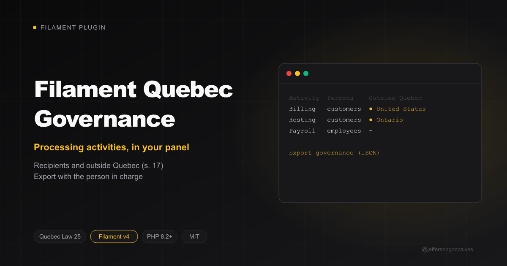

<div class="filament-hidden">



</div>

# Filament Quebec Governance

[](https://packagist.org/packages/jeffersongoncalves/filament-quebec-governance)
[](https://github.com/jeffersongoncalves/filament-quebec-governance/actions?query=workflow%3Atests+branch%3A2.x)
[](https://github.com/jeffersongoncalves/filament-quebec-governance/actions?query=workflow%3A"Fix+PHP+code+styling"+branch%3A2.x)
[](https://packagist.org/packages/jeffersongoncalves/filament-quebec-governance)
[](LICENSE.md)

Manage the processing activities of [laravel-quebec-governance](https://github.com/jeffersongoncalves/laravel-quebec-governance) from your Filament panel, under Quebec's private sector privacy act (Law 25), and export them joined with the personal information you declared in your models.

## Features

- Processing activities: purpose, persons concerned, information, retention and security measures (s. 10).
- Link activities to the models of `quebec.models`: the personal information declared on them joins the activity.
- Recipients (service provider, third party, public body) and communications outside Quebec, each with whether its privacy impact assessment is done (s. 17).
- **Export governance (JSON):** the business, the person in charge, the governance policies and every activity, in one file.
- 19 languages.

## Compatibility

| Plugin Version                                                              | Filament |
|-----------------------------------------------------------------------------|----------|
| [1.x](https://github.com/jeffersongoncalves/filament-quebec-governance/tree/1.x) | 3.x      |
| [2.x](https://github.com/jeffersongoncalves/filament-quebec-governance/tree/2.x) | 4.x      |
| [3.x](https://github.com/jeffersongoncalves/filament-quebec-governance/tree/3.x) | 5.x      |

## Installation

You can install the package via composer:

```bash
composer require jeffersongoncalves/filament-quebec-governance:"^2.0"
php artisan vendor:publish --tag="quebec-governance-migrations"
php artisan migrate
```

The business, the person in charge of the protection of personal information (s. 3.1) and the governance policies (s. 3.2) are configured in laravel-quebec-governance's `quebec-governance` config (or the `QUEBEC_BUSINESS_*` / `QUEBEC_PERSON_IN_CHARGE_*` env variables).

## Usage

```php
use JeffersonGoncalves\Filament\QuebecGovernance\QuebecGovernancePlugin;

public function panel(Panel $panel): Panel
{
    return $panel
        ->plugins([
            QuebecGovernancePlugin::make()
                ->navigationGroup('Quebec')             // default: no group
                ->navigationSort(5)
                ->navigationIcon('heroicon-o-clipboard-document-list')
                ->slug('processing-activities'),
        ]);
}
```

All fluent methods are optional.

> The resource has no authorization of its own: register it only on panels whose users maintain the governance, or add a policy for `JeffersonGoncalves\QuebecGovernance\Models\ProcessingActivity`.

## Testing

```bash
composer test
```

## Changelog

Please see [CHANGELOG](CHANGELOG.md) for more information on what has changed recently.

## Contributing

Please see [CONTRIBUTING](.github/CONTRIBUTING.md) for details.

## Security Vulnerabilities

Please review [our security policy](../../security/policy) on how to report security vulnerabilities.

## Credits

- [Jefferson Gonçalves](https://github.com/jeffersongoncalves)
- [All Contributors](../../contributors)

## License

The MIT License (MIT). Please see [License File](LICENSE.md) for more information.
